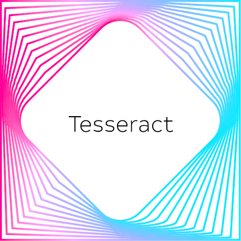
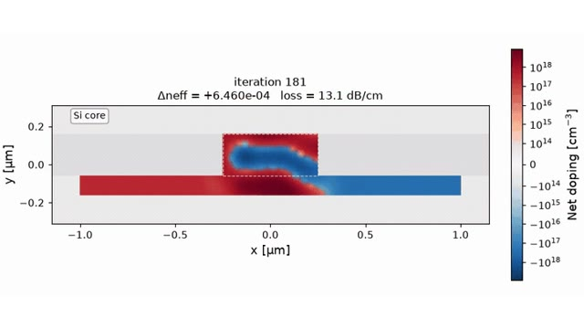
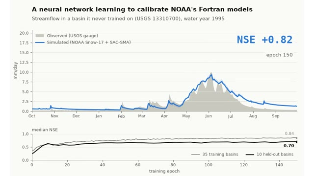
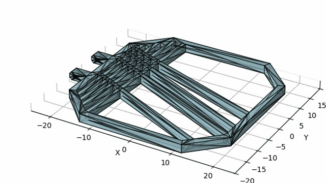
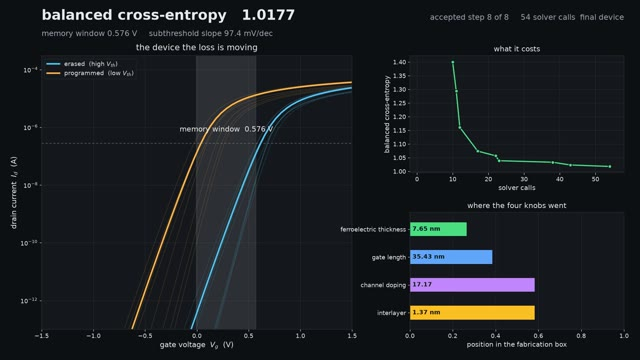
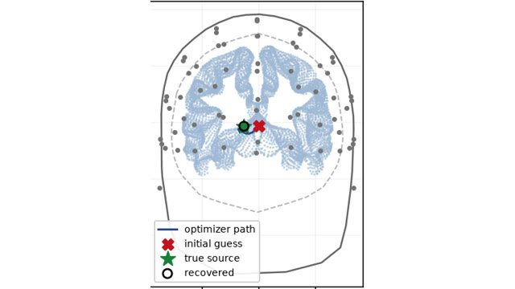
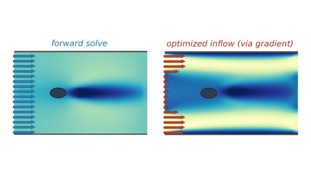

<picture>
  <source media="(prefers-color-scheme: dark)" srcset="docs/static/logo-dark.png" width="128" align="right">
  
</picture>

### Tesseract Core

Universal components for differentiable scientific computing 📦

[Read the docs](https://docs.pasteurlabs.ai/projects/tesseract-core/latest/) |
[API reference](https://docs.pasteurlabs.ai/projects/tesseract-core/latest/content/reference/tesseract-api/) |
[Demos & tutorials](https://docs.pasteurlabs.ai/projects/tesseract-core/latest/content/demo/demo/) |
[Blog](https://docs.pasteurlabs.ai/projects/tesseract-core/latest/blog/) |
[User Forum](https://si-tesseract.discourse.group/) |
[Report an issue](https://github.com/pasteurlabs/tesseract-core/issues) |
[Contribute](https://github.com/pasteurlabs/tesseract-core/blob/main/CONTRIBUTING.md)

---

[](https://doi.org/10.21105/joss.08385)
[](https://proceedings.scipy.org/articles/kvfm5762)

Tesseract wraps any solver behind a typed interface with derivative endpoints, runs it in its own process, and hands it to `jax.grad` or `torch.autograd` as a single differentiable operation.

## How it works

- Define a component in `tesseract_api.py`: Pydantic schemas for its inputs and outputs, an `apply` function, and optional derivative endpoints, computed however you like (autodiff, adjoints, finite differences).
- Run it in its own process and environment, build it as a container image, or serve it remotely. Each way exposes the same endpoints.
- Differentiate through it with [Tesseract-JAX](https://github.com/pasteurlabs/tesseract-jax) and [Tesseract-Torch](https://github.com/pasteurlabs/tesseract-torch), so one gradient can cross languages and frameworks. Overhead is typically a few milliseconds per call (see the [performance guide](https://docs.pasteurlabs.ai/projects/tesseract-core/latest/content/concepts/performance/)).
- Check every derivative endpoint against finite differences with `check-gradients`.

## What you can do with it

<table>
<tr>
<td width="33%" valign="top">
<a href="https://github.com/benvial/prismo"></a>
<b><a href="https://github.com/benvial/prismo">PRISMO</a></b><br>
A Julia semiconductor solver and a FEniCS optics solver in one JAX gradient, reaching more than five times the optical phase shift of the starting design.
</td>
<td width="33%" valign="top">
<a href="https://github.com/kasProg/dSnowSac"></a>
<b><a href="https://github.com/kasProg/dSnowSac">δSnowSac</a></b><br>
A PyTorch network learns to calibrate NOAA's operational Fortran models, Snow-17 and SAC-SMA, with gradients flowing through the untouched Fortran.
</td>
<td width="33%" valign="top">
<a href="https://docs.pasteurlabs.ai/projects/tesseract-core/latest/blog/2025-11-28-rocket-fin-optimization/"></a>
<b><a href="https://docs.pasteurlabs.ai/projects/tesseract-core/latest/blog/2025-11-28-rocket-fin-optimization/">Rocket grid fins</a></b><br>
Ansys SpaceClaim geometry and PyMAPDL structural analysis in one optimization loop, giving a design 24% stiffer than the baseline at the same mass.
</td>
</tr>
<tr>
<td width="33%" valign="top">
<a href="https://github.com/hozaifa1/differentiable-silicon"></a>
<b><a href="https://github.com/hozaifa1/differentiable-silicon">Differentiable Silicon</a></b><br>
Sentaurus TCAD, a closed-source binary driven over SSH, differentiated with finite differences and Broyden updates to tune a transistor for a spiking network.
</td>
<td width="33%" valign="top">
<a href="https://github.com/BrainCapture/NeuroLocate"></a>
<b><a href="https://github.com/BrainCapture/NeuroLocate">NeuroLocate</a></b><br>
A PyTorch network proposes EEG sources, and JAX refines them with gradients through OpenMEEG, a C++ boundary element solver with no autodiff of its own.
</td>
<td width="33%" valign="top">
<a href="https://github.com/pasteurlabs/mosaic"></a>
<b><a href="https://github.com/pasteurlabs/mosaic">Mosaic</a></b><br>
Solvers in C++, Julia, JAX, and PyTorch, from deal.II and OpenFOAM to JAX-FEM and XLB, behind one Tesseract interface, so a single harness can compare their gradients and cost on shared tasks.
</td>
</tr>
</table>

> [!TIP]
> Still unsure whether you need Tesseract? See [When to use Tesseract](https://docs.pasteurlabs.ai/projects/tesseract-core/latest/content/concepts/when-to-use/).

## Quick start

You need Python 3.10+ and [uv](https://docs.astral.sh/uv/getting-started/installation/), which Tesseract uses to build an isolated environment for each component.

```bash
$ pip install tesseract-core tesseract-jax
$ tesseract init --name my-tesseract
```

Replace the generated `tesseract_api.py` with this stand-in for a solver:

```python
# tesseract_api.py
from pydantic import BaseModel
from tesseract_core.runtime import Array, Differentiable, Float32, ShapeDType


class InputSchema(BaseModel):
    x: Differentiable[Array[(None,), Float32]]


class OutputSchema(BaseModel):
    y: Differentiable[Array[(None,), Float32]]


def apply(inputs: InputSchema) -> OutputSchema:
    # Call your solver, mesh generator, or surrogate here
    return OutputSchema(y=inputs.x**2)


def vector_jacobian_product(inputs, vjp_inputs, vjp_outputs, cotangent_vector):
    # Hand-written, autodiff, adjoint solve, finite differences, ...
    return {"x": 2 * inputs.x * cotangent_vector["y"]}


def abstract_eval(abstract_inputs):
    # Output shapes from input shapes, so JAX can trace without running apply
    return {"y": ShapeDType(shape=abstract_inputs.x.shape, dtype="float32")}
```

Run it in its own process and differentiate through it with JAX:

```python
import jax
import jax.numpy as jnp
from tesseract_core import Tesseract
from tesseract_jax import apply_tesseract

with Tesseract.from_source("tesseract_api.py") as solver:
    loss = lambda x: apply_tesseract(solver, {"x": x})["y"].sum()
    print(jax.grad(loss)(jnp.array([1.0, 2.0, 3.0])))  # [2. 4. 6.]
```

[Tesseract-Torch](https://github.com/pasteurlabs/tesseract-torch) does the same for `torch.autograd`. Before an optimizer relies on the hand-written VJP, check it against finite differences:

```bash
$ pip install "tesseract-core[runtime]"
$ TESSERACT_API_PATH=tesseract_api.py tesseract-runtime check-gradients '{"inputs": {"x": [1.0, 2.0, 3.0]}}'
✅ Gradient check for vector_jacobian_product passed ✅ (0 failures / 1000 checks)
```

To share or deploy the component, build the same folder as a container image (this step requires [Docker](https://docs.docker.com/engine/install/)), and `Tesseract.from_image("my-tesseract")` replaces `from_source`:

```bash
$ tesseract build .
$ tesseract run my-tesseract apply '{"inputs": {"x": [1.0, 2.0, 3.0]}}'
```

## The Ecosystem

- **[Tesseract Core](https://github.com/pasteurlabs/tesseract-core)**: CLI, Python SDK, and runtime (this repo).
- **[Tesseract-JAX](https://github.com/pasteurlabs/tesseract-jax)**: embed Tesseracts as JAX primitives, compatible with `jit`, `grad`, and `vmap`.
- **[Tesseract-Torch](https://github.com/pasteurlabs/tesseract-torch)**: embed Tesseracts as PyTorch operators with `torch.autograd` support.

Also see [Tesseract-Streamlit](https://github.com/pasteurlabs/tesseract-streamlit) to generate web apps from Tesseracts, and [cookiecutter-tesseract](https://github.com/pasteurlabs/cookiecutter-tesseract) for a multi-Tesseract project template.

## Learn more

- [Get started](https://docs.pasteurlabs.ai/projects/tesseract-core/latest/content/tutorials/get-started/)
- [Checking gradients](https://docs.pasteurlabs.ai/projects/tesseract-core/latest/content/how-to/check-gradients/)
- [Differentiable programming guide](https://docs.pasteurlabs.ai/projects/tesseract-core/latest/content/concepts/differentiable-programming/)
- [Demos & tutorials](https://docs.pasteurlabs.ai/projects/tesseract-core/latest/content/demo/demo/)
- [Deploying Tesseracts](https://docs.pasteurlabs.ai/projects/tesseract-core/latest/content/how-to/deploy/)

## Citing Tesseract

If you use Tesseract in your research, please cite:

```bibtex
@article{TesseractCore,
  doi = {10.21105/joss.08385},
  url = {https://doi.org/10.21105/joss.08385},
  year = {2025},
  publisher = {The Open Journal},
  volume = {10},
  number = {111},
  pages = {8385},
  author = {Häfner, Dion and Lavin, Alexander},
  title = {Tesseract Core: Universal, autodiff-native software components for Simulation Intelligence},
  journal = {Journal of Open Source Software}
}
```

## License

Tesseract Core is licensed under the [Apache License 2.0](https://github.com/pasteurlabs/tesseract-core/blob/main/LICENSE) and is free to use, modify, and distribute (under the terms of the license).

Tesseract is a registered trademark of Pasteur Labs, Inc. and may not be used without permission.
