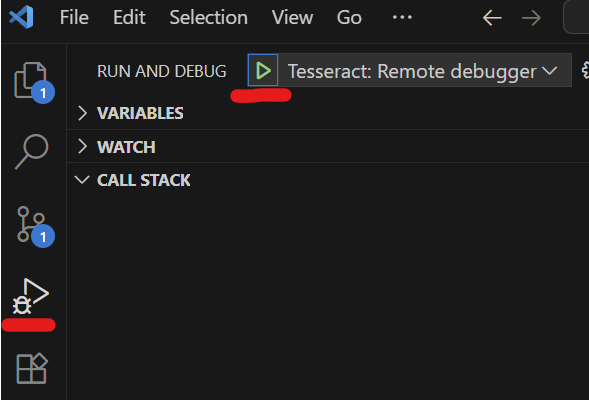

# Debugging guide

This page covers strategies for interactive development and debugging of Tesseracts.

## Running a Tesseract in your current environment

`Tesseract.from_source` and containers run a Tesseract in a separate process.
To step through it with a debugger, it is usually simpler to run it in your current environment, either by importing it into your Python process or with the `tesseract-runtime` CLI.
Both need the Tesseract's dependencies installed in the current environment.
To attach a debugger to the separate process instead, see [Debug mode](#debug-mode).

### Importing into the current process

`Tesseract.from_tesseract_api()` loads your `tesseract_api.py` as a Python module and calls its endpoints directly:

```python
from tesseract_core import Tesseract
import numpy as np

tess = Tesseract.from_tesseract_api("/path/to/your/tesseract_api.py")
result = tess.apply(inputs={"a": np.array([1.0, 2.0]), "b": np.array([3.0, 4.0])})
```

This approach is particularly useful for:

- Interactive development in Jupyter notebooks
- Running unit tests against your Tesseract
- Debugging with Python debuggers like `pdb` or IDE debuggers

### Using `tesseract-runtime`

`tesseract-runtime` calls the same endpoints from the command line:

1. Install the Tesseract runtime: `pip install tesseract-core[runtime]` (see <project:#installation-runtime>).
2. Install your Tesseract's dependencies: `pip install -r tesseract_requirements.txt`
3. Set the `TESSERACT_API_PATH` environment variable, and call an endpoint:
   ```bash
   $ export TESSERACT_API_PATH=/path/to/your/tesseract_api.py
   $ tesseract-runtime apply '{"inputs": {"name": "Tessie"}}'
   ```

If you have served the Tesseract with `Tesseract.from_source` before, you can skip the first two steps. The environment it built in `.tesseract-venv`, next to `tesseract_api.py`, already contains the runtime and the Tesseract's dependencies, so `.tesseract-venv/bin/tesseract-runtime` works as is.

(debug-mode)=

## Debug mode

A Tesseract served in debug mode differs from a regular one in three ways:

- Tracebacks from execution are returned in the response body, instead of a generic 500 error.
  This is useful for debugging and testing, but unsafe for production environments.
- The `test` endpoint is exposed over HTTP.
- A debugpy server is started next to the Tesseract, so you can attach a debugger to it for
  remote debugging sessions.

Without debug mode, a failing request returns a generic HTTP 500 error, so that tracebacks
and other server internals stay hidden from clients. The traceback still goes to the server log.
Read it with `docker logs <container ID>` for containers, or with `Tesseract.server_logs()`
for Tesseracts started through the Python SDK. `tesseract-runtime serve` prints it to the terminal.

To get tracebacks in the response instead, enable debug mode. How depends on how the
Tesseract is served:

- **Containers**: `tesseract serve --debug`.
- **Without containers**: `TESSERACT_DEBUG=1 tesseract-runtime serve`.
- **Python SDK**: `Tesseract.from_image()` and `Tesseract.from_source()` serve in debug mode by default.
- **Remote servers** (`Tesseract.from_url()`): whoever runs the server has to enable debug mode there.

`Tesseract.from_source` starts the debugpy server on a free port on `127.0.0.1`, which you can
look up in `tess.server_logs()`, or choose yourself:

```python
with Tesseract.from_source(
    "/path/to/tesseract_api.py", runtime_config={"debugpy_port": 5678}
) as tess:
    ...
```

Pass `runtime_config={"debug": False}` to turn debug mode off.

With `tesseract serve --debug`, the debugpy port in the container is forwarded to a free port on
the host, which `tesseract serve` displays when it starts.

In particular, if you are using VScode, here is a sample launch config to attach to a running Tesseract in
debug mode:

```json
        {
            "name": "Tesseract: Remote debugger",
            "type": "debugpy",
            "request": "attach",
            "connect": {
                "host": "localhost",
                "port": "PORT_NUMBER_HERE"
            },
            "pathMappings": [
                {
                    "localRoot": "${workspaceFolder}/examples/helloworld",
                    "remoteRoot": "/tesseract"
                }
            ],
        },
```

(make sure to fill in with the actual port number). The `pathMappings` entry maps your source
folder to `/tesseract`, where it lives in the container. A Tesseract served with
`Tesseract.from_source` runs your source files in place, so leave `pathMappings` out for it.
After inserting this into the `configurations`
field of your `launch.json` file, you should be able to attach to the Tesseract being served by clicking on the
green "play" button at the top left corner of the "Run and Debug" tab.



For more information on the VSCode debugger, see [this guide](https://code.visualstudio.com/docs/debugtest/debugging).

### Debugging one-shot commands

`tesseract run` also supports a `--debug` flag, which lets you remotely debug a one-shot command
rather than a long-running server. It works with any command you can run this way (`apply`,
`jacobian`, `check-gradients`, `health`, ...):

```bash
$ tesseract run --debug helloworld apply '{"inputs": {"a": 1.0, "b": 2.0}}'
```

Because `tesseract run` executes a single command and then exits, the runtime starts a debugpy
server inside the container and **blocks until a debugger attaches** before running anything. The
debugger attaches before your `tesseract_api.py` is even imported, so breakpoints in module-level
code (e.g. model loading at import time) are hit as well as those inside the endpoint itself.

The host port to connect to is printed in the CLI when the command starts. Use the same VSCode
launch config as above (filling in the printed port number) to attach; execution resumes
automatically once the debugger is connected.

To do the same with a one-shot `tesseract-runtime` command in your current environment, set
`TESSERACT_DEBUG=1`. The debugger listens on `127.0.0.1:5678` by default (change the port with
`TESSERACT_DEBUGPY_PORT`):

```bash
$ TESSERACT_DEBUG=1 tesseract-runtime apply '{"inputs": {"a": 1.0, "b": 2.0}}'
```

(profiling)=

## Profiling

Tesseract includes built-in profiling support to help identify performance bottlenecks. When profiling is enabled, the runtime collects CPU profiling statistics using Python's `cProfile` module and reports them after each endpoint execution.

### Enabling profiling

There are several ways to enable profiling:

**Via Python SDK:**

Pass `runtime_config={"profiling": True}` to `Tesseract.from_source` or `Tesseract.from_tesseract_api`. The statistics are part of the Tesseract's logs, so pass `stream_logs=True` to print them as calls run:

```python
with Tesseract.from_source(
    "/path/to/tesseract_api.py",
    runtime_config={"profiling": True},
    stream_logs=True,
) as tess:
    tess.apply(inputs)
```

**Via `tesseract-runtime`:**

```bash
$ tesseract-runtime --profiling apply '{"inputs": {...}}'
```

Setting `TESSERACT_PROFILING=1` in the environment has the same effect.

**Via `tesseract run`:**

```bash
$ tesseract run myimage apply '{"inputs": {...}}' --profiling
```

(understanding-profiling-output)=

### Understanding profiling output

When profiling is enabled, you'll see output like this after each endpoint call:

```
--- Profiling Statistics ---
=== By Cumulative Time (includes sub-calls) ===
         1234 function calls in 0.456 seconds

   ncalls  tottime  percall  cumtime  percall filename:lineno(function)
       10    0.100    0.010    0.400    0.040 mymodule.py:42(expensive_function)
      100    0.050    0.001    0.200    0.002 numpy/core/fromnumeric.py:70(sum)
      ...

=== By Total Time (excluding sub-calls) ===
   ncalls  tottime  percall  cumtime  percall filename:lineno(function)
       10    0.100    0.010    0.400    0.040 mymodule.py:42(expensive_function)
      ...
```

The output includes two sorted views:

- **By Cumulative Time**: Shows functions that took the most total time including all sub-calls. Useful for finding high-level bottlenecks.
- **By Total Time**: Shows functions that spent the most time in their own code (excluding sub-calls). Useful for finding low-level hotspots.

```{note}
Framework internals (FastAPI, Starlette, uvicorn, etc.) are automatically filtered out to focus on your code.
```

## Tracing

Tracing provides detailed debug-level logging of Tesseract operations. This is useful for understanding the flow of data through your Tesseract and diagnosing issues.

### Enabling tracing

**Via Python SDK:**

```python
with Tesseract.from_source(
    "/path/to/tesseract_api.py",
    runtime_config={"tracing": True},
    stream_logs=True,
) as tess:
    tess.apply(inputs)
```

**Via `tesseract-runtime`:**

```bash
$ tesseract-runtime --tracing apply '{"inputs": {...}}'
```

Setting `TESSERACT_TRACING=1` in the environment has the same effect.

**Via `tesseract run`:**

```bash
$ tesseract run myimage apply '{"inputs": {...}}' --tracing
```

### Tracing output

When tracing is enabled, you'll see DEBUG-level log messages with timestamps:

```
2024-01-15 10:30:45,123 - tesseract_runtime - DEBUG - Processing apply request
2024-01-15 10:30:45,124 - tesseract_runtime - DEBUG - Input validation complete
2024-01-15 10:30:45,456 - tesseract_runtime - DEBUG - Apply execution complete
```

## Combining profiling and tracing

You can enable both profiling and tracing simultaneously for comprehensive debugging:

```python
with Tesseract.from_source(
    "/path/to/tesseract_api.py",
    runtime_config={"profiling": True, "tracing": True},
    stream_logs=True,
) as tess:
    tess.apply(inputs)
```

The command-line flags combine the same way:

```bash
$ tesseract-runtime --profiling --tracing apply '{"inputs": {...}}'
$ tesseract run myimage apply '{"inputs": {...}}' --profiling --tracing
```

## Debugging build failures

### Verbose build output

By default, `tesseract build` only prints output when something fails, which can make your shell appear unresponsive during long builds. To see real-time progress:

```bash
$ tesseract build --loglevel debug
```

### Inspecting the build context

`tesseract build` creates a temporary folder containing all files passed to `docker build`. To inspect this context (useful for debugging file inclusion issues):

```bash
$ tesseract build --build-dir ./debug_build
```

After running this, `./debug_build` will contain exactly what Docker sees during the build—nothing more, nothing less.

### Overriding configuration

Use `--config-override` to temporarily change settings from `tesseract_config.yaml` without editing the file:

```bash
$ tesseract build --config-override build_config.target_platform=linux/arm64
```

## Debugging tips

### Common issues

1. **Import errors**: If your Tesseract fails to load, check that all dependencies are installed and importable. Use `tesseract-runtime check` to validate your `tesseract_api.py`.

2. **Schema validation errors**: Use tracing to see the exact input being passed and compare it against your schema definition.

3. **Performance issues**: Enable profiling to identify slow functions. Look for:
   - Functions with high `tottime` (time spent in the function itself)
   - Functions called many times (`ncalls` column)
   - Unexpected functions appearing in the profile

### Troubleshooting dependencies

Dependency issues are a common source of build and runtime failures. Here's how to diagnose and fix them:

**Testing dependencies in a clean environment:**

`Tesseract.from_source` builds the Tesseract's environment only from what `tesseract_config.yaml` and `tesseract_requirements.txt` declare, so starting the Tesseract with it checks that the declared dependencies are complete:

```python
from tesseract_core import Tesseract

with Tesseract.from_source("/path/to/tesseract_api.py") as tess:
    print(tess.health())
```

If a dependency is missing, startup fails and shows the `ImportError` raised by `tesseract_api.py`. This does not cover problems specific to a Tesseract image, such as missing system libraries or packages without Linux wheels.

**Common dependency problems:**

- **Missing transitive dependencies**: Your code may depend on a package that's installed as a dependency of something else in your main environment, but not listed in `tesseract_requirements.txt`. The clean environment test above will catch this.

- **Version conflicts**: If you see errors about incompatible versions, use `pip install` with specific version constraints in your requirements file (e.g., `numpy>=1.20,<2.0`).

- **System library dependencies**: Some Python packages require system libraries (e.g., `libgomp` for OpenMP, `libffi` for cffi). If the build succeeds but the container fails at runtime with "library not found" errors, you may need to add system packages via `tesseract_config.yaml`:

  ```yaml
  build_config:
    extra_packages:
      - libgomp1
  ```

### Inspecting containers with Docker

When a Tesseract builds successfully but behaves unexpectedly at runtime, you can use Docker commands to inspect the container state.

**Get a shell inside a served Tesseract:**

```bash
# First, find the container ID
$ docker ps
CONTAINER ID   IMAGE        COMMAND                  ...
a1b2c3d4e5f6   mytesseract  "uvicorn tesseract..."   ...

# Open an interactive shell
$ docker exec -it a1b2c3d4e5f6 /bin/bash
```

From inside the container, you can:

- Check installed packages: `pip list`
- Verify files are in place: `ls -la /tesseract`
- Test imports manually: `python -c "import your_module"`
- Check environment variables: `env | grep TESSERACT`

**Run commands within a Tesseract image interactively:**

```bash
# Start a shell in a new container from the image
$ docker run -it --entrypoint /bin/bash mytesseract:latest
```

**View container logs:**

```bash
# For a running container
$ docker logs a1b2c3d4e5f6

# Follow logs in real-time
$ docker logs -f a1b2c3d4e5f6
```

**Check resource usage:**

```bash
$ docker stats a1b2c3d4e5f6
```

This is useful for diagnosing out-of-memory errors or CPU throttling issues.

### Using Python debuggers

When the Tesseract runs in your current environment via `tesseract-runtime` or `Tesseract.from_tesseract_api()`, you can use standard Python debugging tools:

```python
import pdb

def apply(inputs):
    pdb.set_trace()  # Execution will pause here
    result = expensive_computation(inputs.data)
    return OutputSchema(result=result)
```

Or use your IDE's debugger by setting breakpoints in your `tesseract_api.py` file.

`pdb.set_trace()` does not work in a Tesseract served with `Tesseract.from_source`, since its process has no terminal to read from. Attach a debugger to it instead (see [Debug mode](#debug-mode)).
